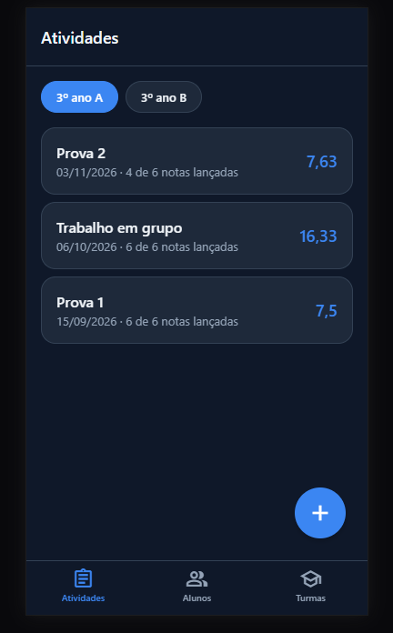
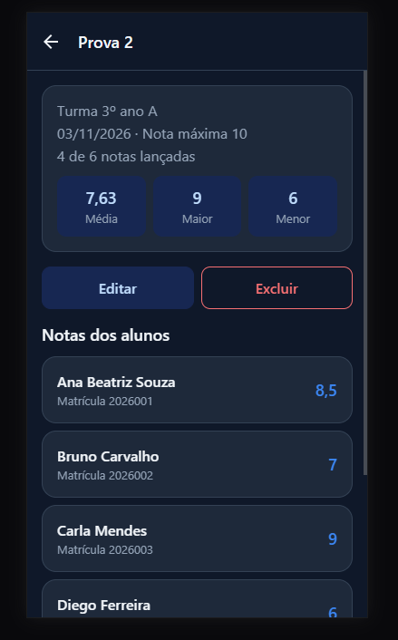
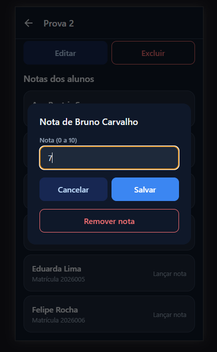
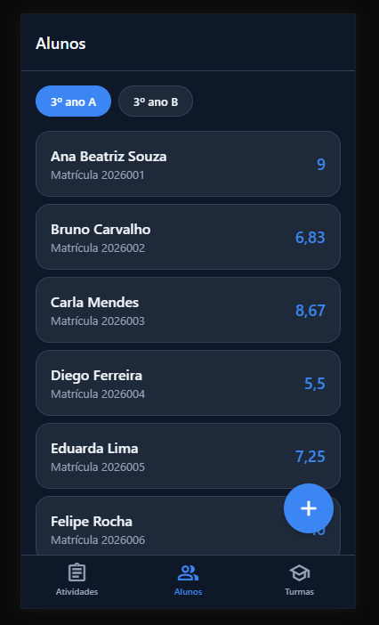
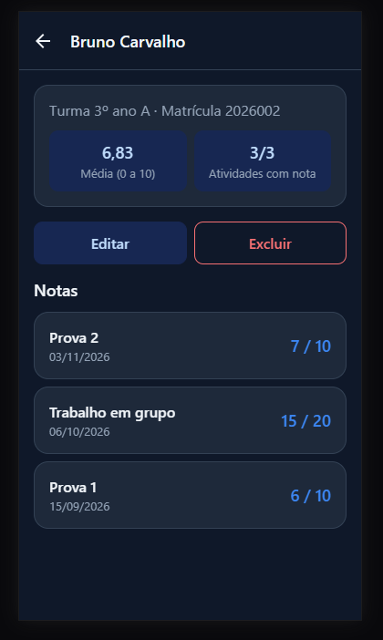
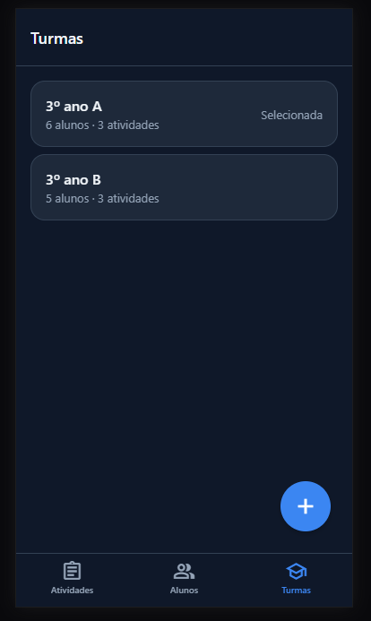
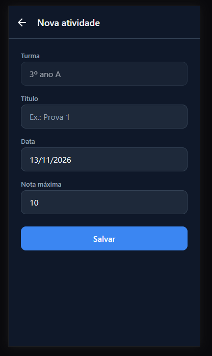
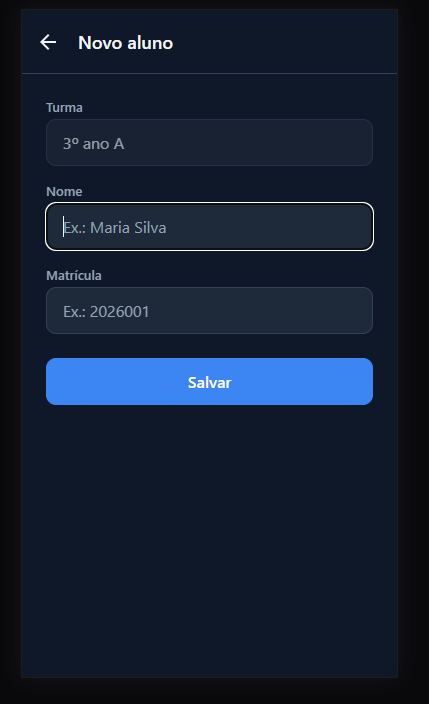
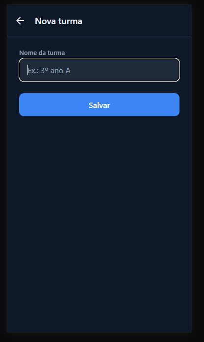

# Caderneta

**Aluno:** Fabio Cordeiro

## Descrição

Aplicativo para professores organizarem suas turmas: cada turma tem seus alunos e suas atividades, e o professor lança a nota de cada aluno em cada atividade. Os dados ficam salvos no próprio celular (AsyncStorage).

Desenvolvido com React Native e Expo como projeto final da disciplina de Framework para Desenvolvimento para Dispositivos Móveis.

## Telas

1. **Atividades** (aba): atividades da turma selecionada, com data, quantas notas foram lançadas e a média da turma.
2. **Nova/Editar atividade**: formulário com título, data e nota máxima, com validação dos campos.
3. **Detalhes da atividade**: resumo (média, maior e menor nota) e lista de alunos da turma; tocar em um aluno abre a janela para lançar a nota.
4. **Alunos** (aba): alunos da turma selecionada, com a média geral de cada um.
5. **Novo/Editar aluno**: formulário com nome e matrícula (a matrícula não pode se repetir na mesma turma).
6. **Boletim do aluno**: média geral (de 0 a 10) e a nota do aluno em cada atividade da turma.
7. **Turmas** (aba): lista das turmas com a quantidade de alunos e atividades de cada uma.
8. **Nova/Editar turma**: formulário com o nome da turma e opção de excluí-la.

Nas abas Atividades e Alunos, a turma é escolhida pelos botões no topo da tela. O app acompanha o tema claro/escuro do celular.

## Tecnologias

- React Native + Expo (SDK 58)
- Expo Router (navegação por abas e pilha)
- AsyncStorage (persistência local)
- TypeScript

## Como rodar

Pré-requisitos: Node.js instalado e o app **Expo Go** no celular (ou um emulador Android/iOS).

```bash
npm install
npx expo start
```

Depois, escaneie o QR code exibido no terminal com o Expo Go (Android) ou com a câmera (iOS).

## Estrutura de pastas

```
src/
  app/          # telas e navegação (Expo Router)
  components/   # componentes reutilizáveis (Button, Input, Card...)
  constants/    # tema: cores, espaçamentos, fontes
  context/      # estado global dos dados + AsyncStorage
  data/         # dados de exemplo (botão na aba Turmas quando o app está vazio)
  hooks/        # useTheme (cores do tema claro/escuro)
  types/        # tipos Turma, Aluno e Atividade
  utils/        # funções auxiliares (notas, datas, ids)
```

## Prints

<table>
  <tr>
    <td align="center"><br>Atividades</td>
    <td align="center"><br>Detalhes da atividade</td>
    <td align="center"><br>Lançar nota</td>
  </tr>
  <tr>
    <td align="center"><br>Alunos</td>
    <td align="center"><br>Boletim do aluno</td>
    <td align="center"><br>Turmas</td>
  </tr>
  <tr>
    <td align="center"><br>Nova atividade</td>
    <td align="center"><br>Novo aluno</td>
    <td align="center"><br>Nova turma</td>
  </tr>
</table>

